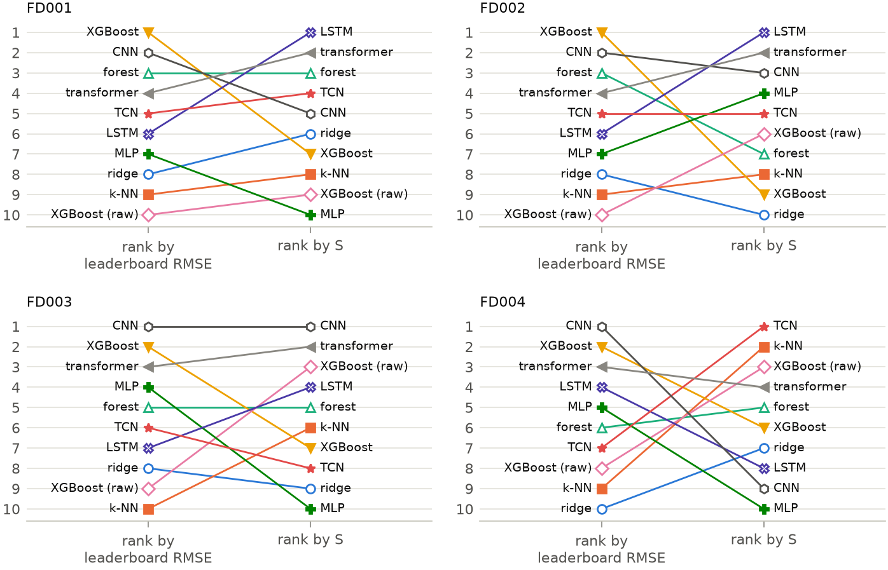
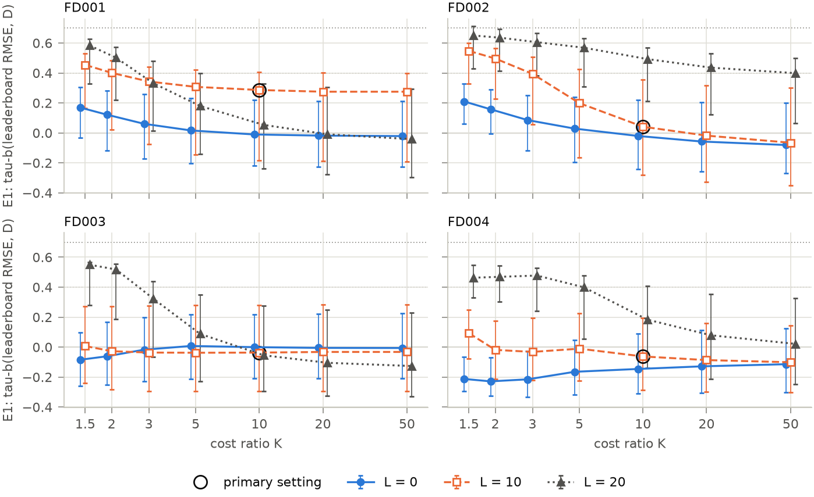
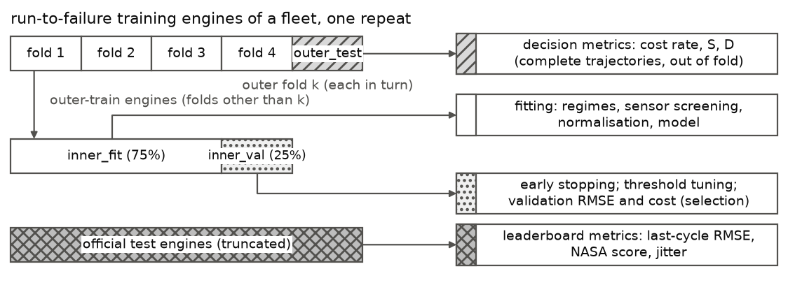

# Research-MaintAdapt-RUL

**Do remaining-useful-life leaderboards predict maintenance value?** Remaining-useful-life (RUL)
papers rank models by RMSE and NASA score at the last observed cycle of the official C-MAPSS test
engines. This repository tests, in a pre-registered study, whether that ranking predicts the
maintenance value of the same models when their predictions drive a tuned maintenance alarm.

## Answer

**H1: supported.** Across 113 configurations of ten model families, ranking by leaderboard RMSE
agrees only weakly with ranking by maintenance value on all four C-MAPSS fleets: Kendall's tau-b
between leaderboard RMSE and decision loss D ranges from -0.062 [-0.285, 0.193] on FD004 to
0.286 [-0.182, 0.408] on FD001 (95% bootstrap intervals; verdicts and rules in
[reports/research/confirmatory/verdicts.md](reports/research/confirmatory/verdicts.md)).

The other two pre-registered hypotheses came out **H2: inconclusive** and **H3: rejected**. The
selection loss E2 is negative on every fleet, with intervals below 0 on FD001 to FD003: models
chosen by validation RMSE kept more maintenance value than models chosen by validation maintenance
cost, the opposite direction to H2.

*Each family's representative (the configuration with the lowest validation RMSE in each fold),
ranked by leaderboard RMSE and by savings share S at the primary setting
(`reports/research/secondary/s3_families.csv`).*

*E1 at every cost ratio K and lead time L of rule R1, with 95% intervals; the circle marks the
primary setting (`reports/research/secondary/s2_settings_grid.csv`).*

## Results

Primary setting: cost ratio K = 10, lead time L = 10 cycles, rule R1 (alarm on the point
prediction), thresholds tuned on validation engines. Point estimates with 95% intervals from
2,000 engine-bootstrap replicates.

| fleet | E1: tau-b(leaderboard RMSE, D) | band | E2: selection loss | E3: delta-tau |
|---|---|---|---|---|
| FD001 | 0.286 [-0.182, 0.408] | weak | -0.882 [-1.710, -0.363] | -0.068 [-0.208, 0.192] |
| FD002 | 0.041 [-0.281, 0.355] | weak | -0.621 [-0.967, -0.324] | -0.050 [-0.209, 0.117] |
| FD003 | -0.037 [-0.295, 0.281] | weak | -1.136 [-1.933, -0.537] | -0.220 [-0.396, 0.126] |
| FD004 | -0.062 [-0.285, 0.193] | weak | -0.129 [-0.297, 0.019] | 0.027 [-0.154, 0.217] |
| verdict | H1: supported | | H2: inconclusive | H3: rejected |
| N-CMAPSS (secondary, descriptive) | 0.677 [0.374, 0.724] | moderate | -0.281 [-0.660, 0.057] | -0.579 [-0.702, -0.302] |

Sources: `reports/research/confirmatory/e1.csv`, `e2.csv`, `e3.csv` and `verdicts.md`
(`make research-confirmatory`); N-CMAPSS: `reports/research/ncmapss/results.md`
(`make research-ncmapss-report`). E1 is Kendall's tau-b between leaderboard RMSE and D = 1 - S
across configurations; E2 is S of the models chosen by validation cost minus S of those chosen by
validation RMSE; E3 is tau-b(jitter, D) minus E1. Every number the paper may quote, with its
source file, column and command, is in
[paper_assets/RESULTS_DIGEST.md](paper_assets/RESULTS_DIGEST.md); `make paper-check` recomputes
the E1-E3 point estimates of every fleet from the prediction archive with independent code.

## Protocol in brief

- **Folds.** For each fleet and each of three repeats, five outer folds over the run-to-failure
  training engines; each outer-train set splits into inner_fit (75%) and inner_val (25%) engines.
- **Model pool.** Ten families (ridge, k-NN, random forest, XGBoost on rolling features and on raw
  readings, MLP, LSTM, TCN, CNN, transformer), 113 configurations, all fitted in every
  (fleet, repeat, fold): 6,780 fits. Everything fitted, from regimes and scalers to the model, sees
  inner_fit engines only.
- **Leaderboard metrics.** RMSE and NASA score at the last observed cycle of the official test
  engines, truth capped at 125, as RUL papers report them.
- **Maintenance value.** An alarm fires at the first cycle whose prediction is at or below a
  threshold tuned on inner_val engines; maintenance follows L cycles later. Preventive maintenance
  costs 1 and a failure K; the cost rate is costs over cycles used, on complete outer_test
  trajectories predicted out of fold. The savings share S places it between age replacement
  tuned on the outer-train lifetimes (S = 0) and perfect prognostics (S = 1).
- **Uncertainty.** Engines are the resampling unit: training engines are drawn once per fleet
  and shared by every configuration, official test engines independently; repeats are averaged.

The full design is in [PREREGISTRATION.md](PREREGISTRATION.md); [DECISIONS.md](DECISIONS.md)
summarises each choice under "Research protocol" and records every implementation detail.

## Confirmatory, secondary and exploratory

| status | what | where |
|---|---|---|
| confirmatory | E1-E3 on FD001-FD004 at the primary setting and the verdicts on H1-H3 | `reports/research/confirmatory/` |
| secondary (pre-registered) | S1-S7 and S9: other accuracy metrics, the settings grid and rule R2, family level, threshold variants (crossfit, oracle, nested), training caps, regret, matched accuracy, the competitive region | `reports/research/secondary/` |
| secondary (pre-registered), descriptive | S8: E1-E3 on N-CMAPSS | `reports/research/ncmapss/` |
| exploratory (not pre-registered) | X1 isotonic recalibration, X2 fixed EMA smoothing, X3 the engineering project's booking evaluation | `reports/research/exploratory/` |

Only the confirmatory analysis decides the verdicts; every other file says what it is in its first
line. The conventional leaderboard of the reference configurations on the engineering project's
80/20 split is in `reports/research/leaderboard_reference.csv`.

## Reproduction

**Hardware and software.** The runs used one NVIDIA RTX 3090 (24 GB), an Intel Core i7-4790K
(4 cores, 8 threads) and 16 GB of RAM under Windows 10, with Python 3.11 and the dependencies
pinned in `pyproject.toml`; every fit records its package versions and hardware in its sidecar.
The code also runs on Linux.

**Data.** C-MAPSS (NASA PCoE data set 6) in `data/raw/CMAPSS/` and N-CMAPSS (data set 17)
extracted in `data/raw/NCMAPSS/data_set/`; `make research-data` checks the C-MAPSS files against
`docs/research/data_manifest.json`.

**Hours.** The CPU stream (ridge, k-NN, forest) ran 6.5 hours and the GPU stream (the other seven
families) 27 hours of wall time side by side; the fits sum to 5.6 and 22.4 hours
(`paper_assets/computed/compute.csv`, from the sidecars). The secondary fits add about 3.5 hours.

**Make targets in order** (`make help` lists all; [docs/research/RUNBOOK.md](docs/research/RUNBOOK.md)
has the details and the times):

| step | command | time |
|---|---|---|
| 1 | `make setup TORCH_INDEX=https://download.pytorch.org/whl/cu128` | minutes |
| 2 | `make research-data` | seconds |
| 3 | `make research-smoke`, then `make research-validate ROOT=smoke` (optional check) | two minutes |
| 4 | `make research-crossfit STREAM=cpu` and `make research-crossfit STREAM=gpu`, in two terminals | 6.5 h and 27 h |
| 5 | `make research-validate`, `make research-outcomes`, `make research-metrics` | about 25 minutes |
| 6 | `make research-confirmatory` | a minute |
| 7 | `make research-nested STREAM=cpu` and `STREAM=gpu`, then `make research-caps`, `make research-extra-validate` | about 1.2 h |
| 8 | `make research-secondary`, `make research-exploratory` | about 20 minutes |
| 9 | `make research-ncmapss-inspect`, `make research-ncmapss-data`, `make research-ncmapss STREAM=cpu` and `STREAM=gpu`, `make research-ncmapss-validate`, `make research-ncmapss-derived`, `make research-ncmapss-report` | about 2.5 h |
| 10 | `make research-leaderboard STREAM=cpu` and `STREAM=gpu` | about an hour |
| 11 | `make paper-assets`, `make paper-check` | about 5 minutes |
| 12 | `make research-package` | a few minutes |

The pool (`configs/research_pool.yaml`) and the folds are committed; `make research-pool` and
`make research-data` rewrite them byte for byte. Steps 5 and 6 refuse to run on the confirmatory
archive unless it validates and the tag `analysis-frozen` exists, and the analysis code equals its
tagged version. The fitting targets resume where they stopped.

## Prediction archive

The predictions of every fit are archived at ZENODO-DOI-PLACEHOLDER (CC BY 4.0), packaged by
`make research-package` with the folds, the pool, the data manifest and SHA-256 checksums
(`README_ARCHIVE.md` inside the package describes it). Each fit is one Parquet file and one JSON
sidecar, `archive/<fleet>/<family>/<config_id>/r<repeat>_f<fold>.parquet`, with one row per cycle
of every inner_val, outer_test and official test engine:

| column | type | meaning |
|---|---|---|
| `unit_id` | int32 | engine id |
| `cycle` | int32 | cycle |
| `rul` | int32 | uncapped true RUL at that cycle |
| `split` | dictionary | `inner_val`, `outer_test` or `official_test` |
| `pred` | float32 | predicted RUL, clipped to [0, 125] |

The sidecar holds the configuration and its hash, the seed, the status and attempts, the
inner_val RMSE, timings, device, package versions, hardware and the commit the fit ran from.
`maintadapt.research.archive.load` reads many fits at once. The archives of the secondary fits
(S4 nested, S5 caps, N-CMAPSS) share the format.

## Pre-registration and deviations

The design was registered on OSF before any confirmatory fit: <https://osf.io/mh9zy>
(DOI [10.17605/OSF.IO/MH9ZY](https://doi.org/10.17605/OSF.IO/MH9ZY)), frozen in this repository at
the tag `prereg-v1`. The analysis code was tagged `analysis-frozen` before the confirmatory fits
started. Every change after registration is in [DEVIATIONS.md](DEVIATIONS.md): four, which
concern N-CMAPSS and the description of the hardware and change no confirmatory result.

## The engineering project and its errata

This repository is a fork of the engineering project maintadapt-rul at the tag `fork-point`. Its
README is kept in [docs/legacy/README_engineering.md](docs/legacy/README_engineering.md), and its
pipeline still runs unchanged (`make data`, `make legacy-train`, `make legacy-eval`,
`make legacy-report`). Three of its claims are corrected and one is put in context in
[docs/legacy/ERRATA.md](docs/legacy/ERRATA.md): the XGBoost interval described as calibrated, the
decision analysis on truncated test engines, and the meaning of its ± values.

## Limitations

- **Simulated data.** C-MAPSS and N-CMAPSS are simulated turbofan degradation; the agreement
  between leaderboard and maintenance value on real fleets is not tested here.
- **Assumed costs.** The cost model has two prices, a preventive action and a failure K times
  dearer, and the results depend on K and the lead time L (`reports/research/secondary/s2_*`);
  no real cost data were used.
- **One component.** Each engine is maintained alone; there is no grouping of maintenance across
  engines or components.
- **No capacity constraints.** Every alarm is acted on L cycles later, whatever the number of
  other alarms.
- **No censoring.** Maintenance value is measured on run-to-failure trajectories, which end in a
  failure; fleets in service also have engines removed or still running, which this design does
  not model.

## Citation

Cite the software and the archive with [CITATION.cff](CITATION.cff) (GitHub's "Cite this
repository" renders it), and the design with the OSF registration above.

## Licence

Code: MIT ([LICENSE](LICENSE)). Prediction archive: CC BY 4.0. The C-MAPSS and N-CMAPSS data are
NASA's and are not redistributed here.
