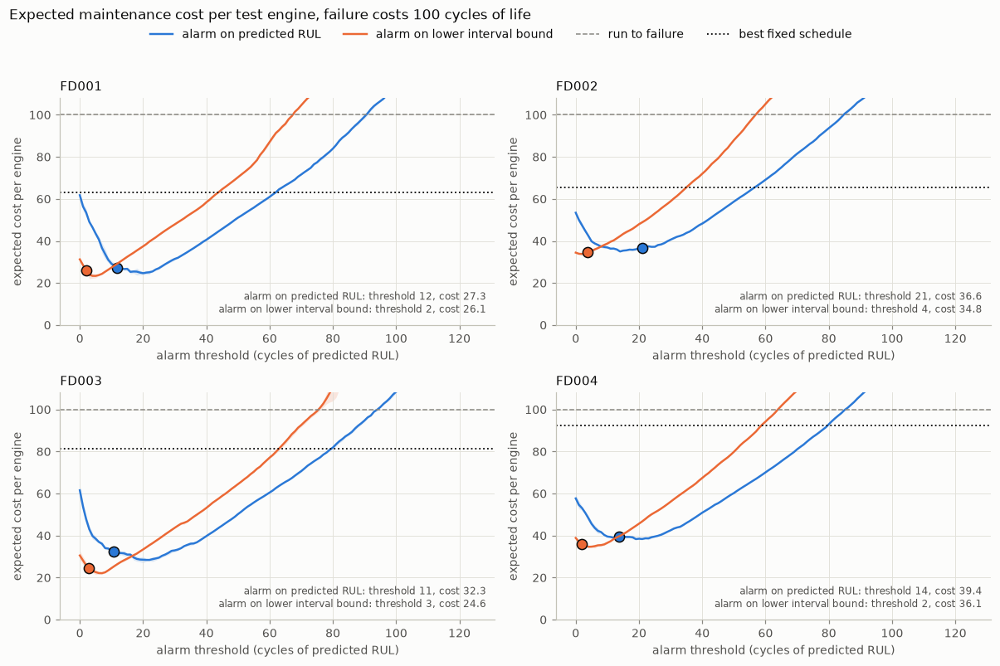
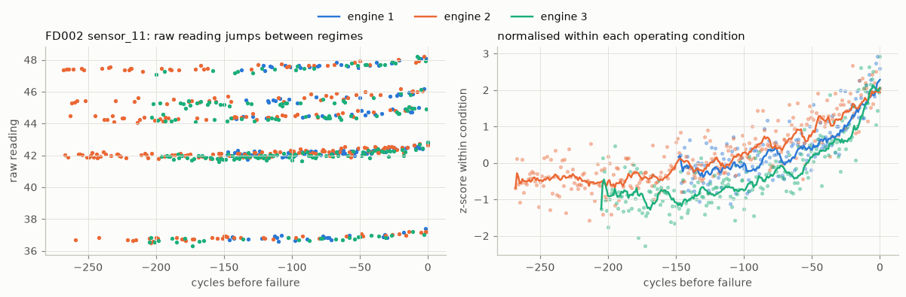
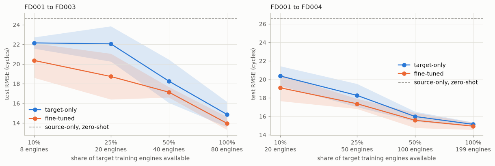
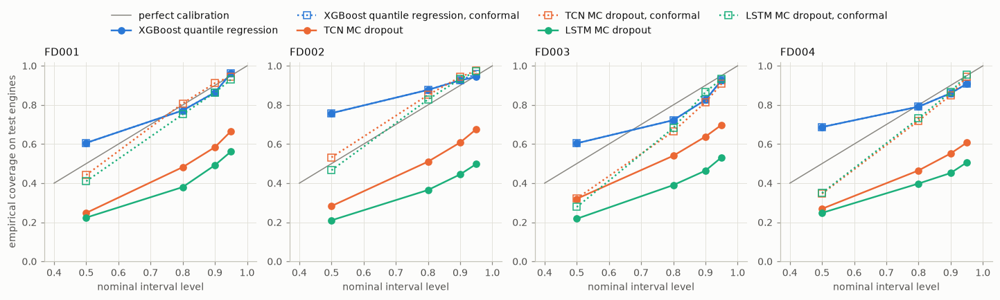
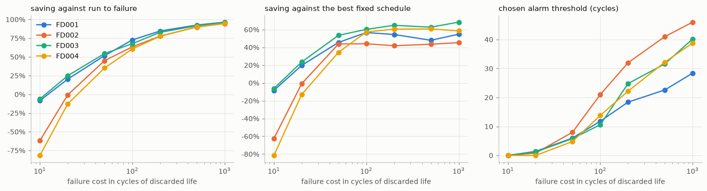
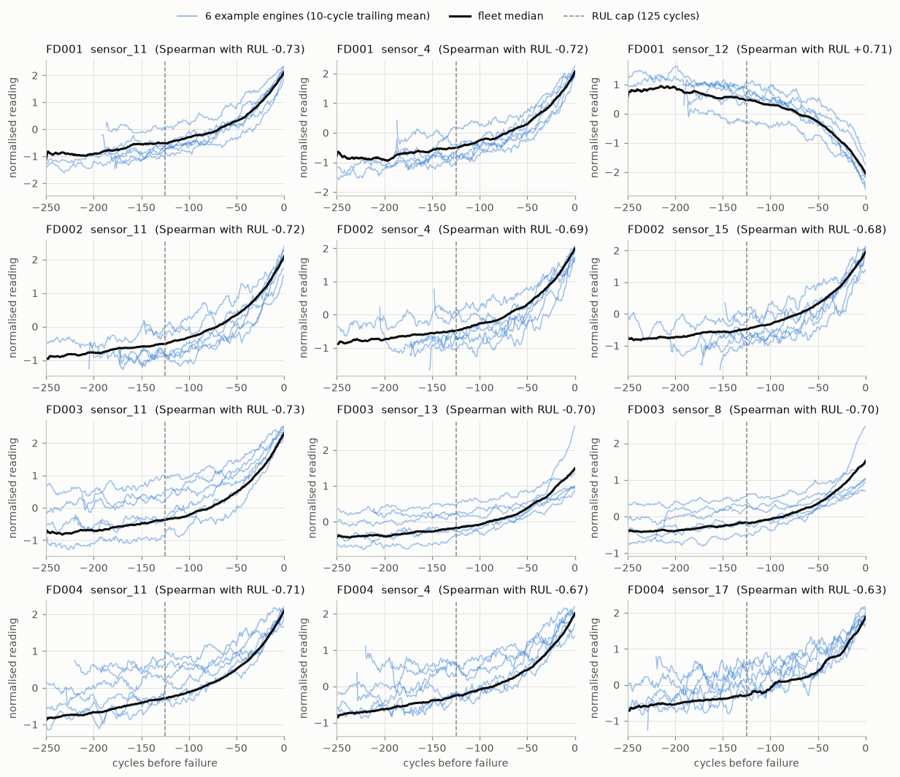

> This page describes the engineering project maintadapt-rul at tag `fork-point`. Its `make train`, `eval` and `report` targets are now `legacy-train`, `legacy-eval` and `legacy-report`, and its corrections are in [ERRATA.md](ERRATA.md).

# MaintAdapt — Predictive Maintenance and Remaining Useful Life

When should a turbofan engine come off the wing? Pull it too late and it fails in service, an
unplanned event that costs far more than any shop visit. Pull it too early and every cycle of
healthy life it had left is thrown away. MaintAdapt treats remaining-useful-life (RUL) prediction
on the NASA C-MAPSS fleet as an input to that decision, not as a regression leaderboard: models are
compared under unit-level splits with classical baselines first, their uncertainty is measured
against what actually happened, and their predictions are turned into a cost-optimal alarm
threshold under an explicit, openly stated cost model. The headline number is the maintenance cost
saved per engine against running to failure and against a fixed maintenance schedule.

**Headline.** If an unplanned failure costs as much as throwing away 100 cycles of healthy engine
life, an alarm on predicted RUL cuts expected maintenance cost per engine by 61% to 73% against
running to failure, and by 44% to 60% against the best fixed maintenance schedule, on the official
test engines of all four C-MAPSS fleets. Alarming on the lower edge of a calibrated 90% prediction
interval does better still on every fleet: 64% to 75% against running to failure.

## Results

Every number below is produced by the `make` targets and read from `reports/`; ± is the standard
deviation over five seeds.

### Maintenance cost against running to failure

Predictions from XGBoost drive an alarm: an engine is serviced once its predicted RUL, or the lower
edge of its interval, reaches a threshold. A failure costs 100 units and each cycle of remaining
life thrown away costs 1, so only their ratio matters and it is stated in cycles. The threshold is
tuned on validation engines and applied unchanged to the official test engines. The fixed schedule
services every engine at one age, tuned on training-engine lifetimes.

Expected cost per test engine:

| fleet | run to failure | best fixed schedule | alarm on predicted RUL | alarm on lower 90% bound |
|---|---|---|---|---|
| FD001 | 100.0 | 63.1 | 27.3 ± 0.8 | 26.1 ± 0.7 |
| FD002 | 100.0 | 65.4 | 36.6 ± 0.5 | 34.8 ± 0.6 |
| FD003 | 100.0 | 81.3 | 32.3 ± 0.9 | 24.6 ± 1.3 |
| FD004 | 100.0 | 92.3 | 39.4 ± 0.2 | 36.1 ± 0.6 |



Both prediction-driven policies beat both references on every fleet. The fixed schedule is a weak
alternative on the two-fault fleets because their lifetimes vary widely: on FD004 it services
every engine at age 225, discards 86 cycles per serviced engine and still lets 46% fail. Alarming on
the lower edge of the calibrated interval is cheaper than alarming on the point prediction on all
four fleets, most clearly on FD003 (24.6 against 32.3 per engine), because it pulls uncertain
engines earlier and cuts the failure rate from 20% to 9%. Thresholds, failure rates, discarded
cycles and savings for every fleet are in [reports/decision_analysis.md](../../reports/decision_analysis.md),
which also sets out what an operator should do.

### Remaining-useful-life models

Scored at the last observed cycle of every official test engine, against truth capped at 125
cycles (see [DECISIONS.md](../../DECISIONS.md)).

Test RMSE in cycles:

| model | FD001 | FD002 | FD003 | FD004 |
|---|---|---|---|---|
| Ridge, rolling features | 14.99 ± 0.00 | 15.96 ± 0.00 | 16.29 ± 0.00 | 18.53 ± 0.00 |
| XGBoost, rolling features | 12.14 ± 0.09 | 12.60 ± 0.05 | 12.49 ± 0.18 | 13.49 ± 0.10 |
| TCN, raw windows | 14.69 ± 0.43 | 14.35 ± 0.30 | 14.42 ± 0.48 | 16.15 ± 0.23 |
| LSTM, raw windows | 14.52 ± 0.62 | 14.68 ± 0.32 | 13.66 ± 0.77 | 15.25 ± 0.32 |

NASA score, summed over test engines, where late predictions cost more than early ones:

| model | FD001 | FD002 | FD003 | FD004 |
|---|---|---|---|---|
| Ridge, rolling features | 347 ± 0 | 1179 ± 0 | 508 ± 0 | 1596 ± 0 |
| XGBoost, rolling features | 214 ± 5 | 690 ± 12 | 262 ± 10 | 819 ± 21 |
| TCN, raw windows | 395 ± 65 | 1059 ± 130 | 553 ± 154 | 1703 ± 213 |
| LSTM, raw windows | 413 ± 52 | 1108 ± 194 | 436 ± 118 | 1408 ± 310 |

XGBoost beats ridge on every subset, by 2.9 to 5.0 cycles of RMSE, and roughly halves the NASA
score. Ridge is deterministic given the split, so its spread across seeds is zero.

**The deep sequence models do not beat XGBoost on any subset.** Trained on raw 30-cycle windows
under the same protocol and without tuning, the TCN and LSTM trail XGBoost by 1.2 to 2.7 cycles of
RMSE, and every gap is significant across seeds; their seed-to-seed spread is also 2 to 7 times
larger. Welch t-test on per-seed test RMSE (`reports/deep_vs_xgboost.csv`):

| subset | TCN minus XGBoost | p | LSTM minus XGBoost | p |
|---|---|---|---|---|
| FD001 | +2.55 | 0.0001 | +2.38 | 0.0009 |
| FD002 | +1.75 | 0.0001 | +2.08 | 0.0001 |
| FD003 | +1.93 | 0.0004 | +1.17 | 0.0254 |
| FD004 | +2.65 | < 0.0001 | +1.76 | 0.0001 |

Normalising each sensor within its operating regime is what makes the multi-regime subsets
tractable (XGBoost, same settings). A raw reading mostly says which regime the engine is flying;
within a regime, the degradation trend appears:



| subset | normalisation | RMSE | NASA score |
|---|---|---|---|
| FD002 | condition-aware | 12.60 ± 0.05 | 690 ± 12 |
| FD002 | global | 15.91 ± 0.13 | 1257 ± 31 |
| FD004 | condition-aware | 13.49 ± 0.10 | 819 ± 21 |
| FD004 | global | 17.39 ± 0.09 | 1713 ± 58 |

### Transfer between operating regimes

An LSTM pretrained on FD001 (one regime, one fault mode) is applied to FD003 (a second fault mode)
and FD004 (a second fault mode and six regimes): unchanged, trained from scratch on the target, or
fine-tuned, with 10% to 100% of the target's training engines.



| target | target engines used | trained from scratch | fine-tuned from FD001 | gain from fine-tuning (Welch) | FD001 model, zero-shot |
|---|---|---|---|---|---|
| FD003 | none |  |  |  | 24.65 ± 1.54 |
| FD003 | 8 (10%) | 22.15 ± 0.58 | 20.37 ± 1.76 | +1.79 (p = 0.085) |  |
| FD003 | 20 (25%) | 22.06 ± 1.79 | 18.73 ± 2.33 | +3.33 (p = 0.037) |  |
| FD003 | 40 (50%) | 18.26 ± 2.20 | 17.14 ± 0.53 | +1.12 (p = 0.324) |  |
| FD003 | 80 (100%) | 14.88 ± 1.29 | 13.97 ± 0.66 | +0.90 (p = 0.212) |  |
| FD004 | none |  |  |  | 26.60 ± 1.88 |
| FD004 | 20 (10%) | 20.37 ± 1.07 | 19.09 ± 1.43 | +1.28 (p = 0.151) |  |
| FD004 | 50 (25%) | 18.27 ± 1.25 | 17.37 ± 0.55 | +0.90 (p = 0.195) |  |
| FD004 | 100 (50%) | 15.99 ± 0.54 | 15.57 ± 0.82 | +0.41 (p = 0.378) |  |
| FD004 | 199 (100%) | 15.14 ± 0.23 | 14.95 ± 0.39 | +0.20 (p = 0.366) |  |

Zero-shot transfer does not work: the FD001 model does worse on the target test engines than a
model trained from scratch on just 8 FD003 engines or 20 FD004 engines. Fine-tuning is ahead of
training from scratch at every budget on both targets, and its lead is largest at the 10% and 25%
budgets, but with five seeds only the 25% FD003 budget clears p < 0.05 (+3.3 cycles). On FD004 the
gain falls from +1.3 cycles at 10% to +0.2 at the full budget. From about half of the target data
onwards, pretraining on FD001 stops mattering.

### Prediction intervals: coverage and calibration

Share of test engines whose capped true RUL falls inside the nominal 90% interval, before and after
split conformal calibration on validation engines:

| subset | interval | coverage | mean width (cycles) | coverage after conformal calibration | calibrated width (cycles) |
|---|---|---|---|---|---|
| FD001 | XGBoost quantile regression | 86% ± 1% | 66.8 ± 0.2 | 86% ± 1% | 66.8 ± 0.2 |
| FD001 | TCN MC dropout | 58% ± 4% | 22.4 ± 1.1 | 91% ± 1% | 44.7 ± 0.7 |
| FD001 | LSTM MC dropout | 49% ± 5% | 15.2 ± 0.9 | 86% ± 2% | 40.7 ± 1.6 |
| FD002 | XGBoost quantile regression | 93% ± 1% | 70.6 ± 0.3 | 93% ± 1% | 70.7 ± 0.3 |
| FD002 | TCN MC dropout | 61% ± 2% | 20.6 ± 0.6 | 94% ± 1% | 54.0 ± 0.8 |
| FD002 | LSTM MC dropout | 44% ± 3% | 13.1 ± 1.2 | 93% ± 1% | 53.4 ± 0.6 |
| FD003 | XGBoost quantile regression | 83% ± 2% | 61.9 ± 0.2 | 83% ± 2% | 61.9 ± 0.2 |
| FD003 | TCN MC dropout | 64% ± 4% | 19.5 ± 0.9 | 81% ± 3% | 31.8 ± 1.8 |
| FD003 | LSTM MC dropout | 46% ± 4% | 13.0 ± 1.0 | 87% ± 2% | 35.6 ± 0.5 |
| FD004 | XGBoost quantile regression | 86% ± 0% | 62.0 ± 0.2 | 86% ± 0% | 62.0 ± 0.2 |
| FD004 | TCN MC dropout | 55% ± 2% | 19.3 ± 0.8 | 85% ± 1% | 43.1 ± 0.4 |
| FD004 | LSTM MC dropout | 45% ± 1% | 13.2 ± 1.6 | 87% ± 1% | 44.4 ± 0.9 |



XGBoost's quantile regression comes closest to its promise: its nominal 90% interval covers 83% to
93% of test engines. MC dropout does not. The sequence models' 90% intervals cover only 44% to 64%,
because dropout sampling captures the network's own uncertainty and none of the noise in the data.
Split conformal calibration on validation engines widens them to cover 81% to 94%. It cannot repair
XGBoost's shortfall on FD001, FD003 and FD004: many validation rows are early-life cycles at the
125-cycle cap, which any interval covers, so the calibration margin comes out at zero.

### The cost-optimal threshold and its sensitivity

The cost of a failure relative to a cycle of life is an assumption, so the whole analysis is
repeated from 10 to 1,000 cycles. Tuned threshold on predicted RUL, in cycles:

| failure cost (cycles) | FD001 | FD002 | FD003 | FD004 |
|---|---|---|---|---|
| 10 | 0 | 0 | 0 | 0 |
| 20 | 1 | 1 | 1 | 0 |
| 50 | 6 | 8 | 6 | 5 |
| 100 | 12 | 21 | 11 | 14 |
| 200 | 18 | 32 | 25 | 22 |
| 500 | 23 | 41 | 32 | 32 |
| 1000 | 28 | 46 | 40 | 39 |



The threshold rises with the cost of a failure, from zero, which means never alarming early, at 10
cycles to 28 to 46 cycles at 1,000. Prediction-driven maintenance only pays once failures are
expensive: at a failure cost of 10 cycles it costs more than running to failure on every fleet, and
at 20 cycles it still loses on FD002 and FD004. Against the best fixed schedule, the saving settles
between 42% and 68% once a failure costs 100 cycles or more.

## How it works

1. **Data** (`src/maintadapt/data.py`). Parse the four C-MAPSS subsets, label every cycle with its
   remaining useful life capped at 125, split engines (never cycles) into train and validation,
   find the operating regimes, and drop sensors that cannot show a trend.
2. **Features** (`features.py`). Normalise each sensor within its regime using training engines
   only, then add trailing means, spreads and slopes over 5 to 30 cycles.
3. **Models** (`baselines.py`, `sequence.py`). Ridge and XGBoost on the rolling features; a TCN and
   an LSTM on 30-cycle windows of normalised readings. Same splits, seeds and test protocol for all
   four.
4. **Transfer** (`transfer.py`). Pretrain on the single-regime FD001 fleet, then fine-tune on FD003
   and FD004 with 10% to 100% of their training engines.
5. **Uncertainty** (`uncertainty.py`). Quantile-regression and MC-dropout intervals, checked for
   coverage on the test engines and corrected by split conformal calibration.
6. **Decision** (`decision.py`). Replay each engine's predictions against an alarm threshold, price
   failures and discarded life, choose the threshold on validation engines, and compare the result
   with running to failure and with a fixed maintenance schedule.

Every non-obvious choice, from the RUL cap to the cost model, is logged with its reason in
[DECISIONS.md](../../DECISIONS.md).

## Reproducing the results

### Setup

Requires Python 3.11 and GNU make. `make setup` creates `.venv` and installs the pinned
dependencies from `pyproject.toml`:

```bash
make setup                                                    # CPU build of PyTorch
make setup TORCH_INDEX=https://download.pytorch.org/whl/cu128 # CUDA build of PyTorch
```

`PYTHON` selects the interpreter used to create the environment (default `python3.11`), for
example `make setup PYTHON="py -3.11"` on Windows. A GPU is optional; only the sequence models and
the transfer study use it.

### Data

The C-MAPSS turbofan degradation data (Saxena et al., PHM 2008) is not redistributed here. Download
data set 6, "Turbofan Engine Degradation Simulation", from the
[NASA Prognostics Center of Excellence data set repository](https://www.nasa.gov/intelligent-systems-division/discovery-and-systems-health/pcoe/pcoe-data-set-repository/)
(or the Kaggle mirror `behrad3d/nasa-cmaps`), unzip it, and place the twelve text files under
`data/raw/CMAPSS/`:

```
data/raw/CMAPSS/train_FD001.txt   test_FD001.txt   RUL_FD001.txt
data/raw/CMAPSS/train_FD002.txt   test_FD002.txt   RUL_FD002.txt
data/raw/CMAPSS/train_FD003.txt   test_FD003.txt   RUL_FD003.txt
data/raw/CMAPSS/train_FD004.txt   test_FD004.txt   RUL_FD004.txt
```

`make data` checks the files, writes the unit-level train/validation splits to
`configs/splits.json`, and produces the dataset report in `reports/`, including the degradation
trajectories below.



### Usage

```bash
make data     # check the raw files, write configs/splits.json, dataset report and figures
make train    # ridge, XGBoost, TCN and LSTM on every subset and seed, then the transfer study
make eval     # prediction intervals and the cost-optimal maintenance policy
make report   # reports/results.csv and the markdown tables quoted in this README
make lint test
```

On one RTX 3090 with an 8-core CPU, `make train` took about 50 minutes (baselines 15, sequence
models 19, transfer study 14) and `make eval` about 80 minutes, most of it fitting the
multi-quantile XGBoost models.

Every experiment reads `configs/default.yaml` (override with `CONFIG=...`) and writes the exact
config it used to `runs/<experiment>/config.yaml`. Finished runs are recorded in
`runs/<experiment>/progress.csv`, so an interrupted experiment resumes where it stopped as long as
the config is unchanged. Runs are also logged to a local MLflow store:

```bash
.venv/bin/mlflow ui --backend-store-uri sqlite:///mlruns/mlflow.db
```

## Limitations

- **Simulated engines.** C-MAPSS comes from a thermodynamic simulation with injected faults and
  additive noise. Real fleets have sensor drift and dropouts, maintenance events that reset
  degradation fully or partly, varying mission profiles, and far fewer run-to-failure histories,
  because engines are usually removed before they fail.
- **Assumed cost ratio.** The cost of an unplanned failure relative to a cycle of discarded life is
  an input, not a measurement. It depends on the operator, the engine type, secondary damage and
  spare availability. The sensitivity analysis shows how the threshold and the saving move with it,
  but a deployment needs the operator's own figures.
- **Simplified maintenance.** Maintenance is priced only through discarded life, is assumed to
  restore the engine fully, and can happen in the cycle the alarm fires. Lead times, shop capacity
  and the fixed cost of a shop visit are left out.
- **Censored test histories.** Test engines stop before failure, so for engines without an alarm
  the decision analysis has to extend the last prediction forward.
- **What real fleet data would change.** Labels would be censored, which calls for survival models
  rather than capped regression. Splits would be by time as well as by engine. Costs could be
  estimated from maintenance records rather than assumed. The threshold would be re-tuned per fleet
  and monitored as engines age, and interval calibration would need the same monitoring.

## License

MIT — see [LICENSE](../../LICENSE).
